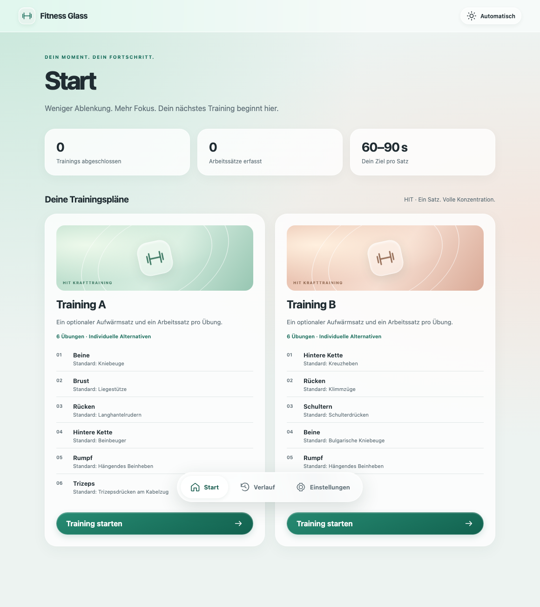

# Fitness Glass

A separate, local-first desktop version of [Fitness PWA](https://github.com/ghinta/fitness-pwa), built with **Tauri v2**, TypeScript, Vite, and Dexie. Training plans, exercise alternatives, warmup/working sets, timers, history, images, and import of existing PWA JSON backups are retained.

Browser preview: [https://ghinta.github.io/fitness-tauri/](https://ghinta.github.io/fitness-tauri/)



## Run

Install Node.js 24+, a stable Rust toolchain, and the [Tauri prerequisites](https://v2.tauri.app/start/prerequisites/) for your OS.

```sh
npm ci
npm run desktop:dev
```

For a browser preview of the frontend:

```sh
npm run dev
```

The preview runs at `http://127.0.0.1:1420`. Native dialogs and window effects are active in the desktop app. The browser preview uses browser dialogs/downloads.

## Test on your phone

Open [Fitness Glass browser preview](https://ghinta.github.io/fitness-tauri/) in Safari or Chrome on your phone. The preview runs the current frontend from `main`, including optional weights and automatic warmup saving. It uses the browser's own local database; desktop data is available through JSON export/import, with no automatic synchronization. Its controls use the CSS glass treatment; the native desktop window material is only available in the desktop app.

HTTPS enables browser features such as Screen Wake Lock and secure ID generation. A plain HTTP LAN preview cannot fully exercise these features. The browser preview has no service worker and is intended for online testing. The **Publish browser preview** workflow builds, validates, and deploys it to GitHub Pages on pushes to `main`.

A native iOS or Android app requires separate mobile project initialization, platform build tools, and signing; no mobile installer is currently generated by this repository.

## Build

```sh
npm run desktop:build
```

Installers appear in `src-tauri/target/release/bundle/`. On macOS, build just the app with `npm run desktop:build -- --bundles app`.

CI validates the frontend and compiles the desktop app on macOS, Windows, and Linux. The **Desktop installers** workflow can be dispatched manually or started with a `v*` tag; it creates a draft release with unsigned installers. Code signing and Apple notarization require your own certificates and are not configured.

## Liquid Glass

On macOS 26+, Tauri's `liquidGlassRegular` window material uses the system's native Liquid Glass. Earlier macOS versions fall back to the native sidebar material. The macOS configuration enables transparent windows and the overlay title bar with native traffic-light controls. This uses Tauri's macOS private API feature and is intended for distribution outside the Mac App Store.

Navigation and web controls use a Liquid Glass-inspired CSS treatment, rounded capsules, translucent layers, restrained highlights, and system typography. These are HTML controls, rather than native SwiftUI/AppKit widgets. Windows, Linux, and browser previews use the same visual frontend without macOS window materials. There are automatic, light, and dark appearances, plus reduced-motion, reduced-transparency, and increased-contrast accommodations.

Reference: [Tauri window effects](https://v2.tauri.app/reference/config/#windoweffect), [Apple Liquid Glass guidance](https://developer.apple.com/documentation/TechnologyOverviews/adopting-liquid-glass).

## Move your existing training data

1. Export all data from Fitness PWA under **Einstellungen → Sicherung**.
2. Open Fitness Glass and select the exported JSON under **Sicherung importieren**.
3. Review the import summary and confirm. Save the backup of the current desktop data first.

The apps have independent local databases. Cancelling the native backup save dialog or a failed write leaves current data intact and aborts the import. Imported backups preserve plans, sessions, results, and exercise images. Weight is optional for all sets; it is stored as unrecorded rather than zero. Older PWA versions cannot import desktop backups containing unrecorded weights for exercises with external loads. Data is local and unencrypted; there is no account, telemetry, or cloud synchronization.

## Training controls and screen timeout

Start and stop the timer without entering a weight. Duration is measured automatically and can be corrected after stopping. Starting the working set automatically saves a stopped warmup, including any corrected values and notes; the separate warmup save button is optional. Timer actions update the current form in place, preserving its scroll position and drafts in the other set. Number inputs keep numeric validation and keyboard entry without browser spinner arrows.

**Bildschirm wach halten** is enabled by default while the training screen is visible. The desktop app requests a native display power assertion through `keepawake`; the browser preview uses Screen Wake Lock when available. Leaving the training screen, hiding it, switching the option off, or closing the app releases the assertion. This prevents automatic display dimming, while preserving manual lock/sleep behavior. Browsers can refuse or release a wake lock in power-saving mode; the app shows a message if the request is unavailable.

## Checks

```sh
npm run format:check
npm run lint
npm test
npm run build
npx playwright install chromium webkit
npm run test:e2e
```

The browser suite covers complete workouts, timer recovery, backup/restore, exercise editing, images, appearance, scroll stability, optional weights, draft retention, and responsive layout in desktop Chromium and mobile WebKit. Native backup tests exercise cancelled dialogs and failed writes. These do not replace testing the native material on each supported macOS release.

## Layout

- `src/domain`, `src/storage`, `src/services`: data model and training logic inherited from Fitness PWA.
- `src/views`, `src/components`, `src/styles`: German interface and glass treatment.
- `src/platform`: native dialogs, window-close protection, and screen-wake lifecycle.
- `src-tauri`: Rust app, platform configuration, narrowly scoped capabilities, and icons.
- `docs/DATA_MODEL.md`: shared data model and backup rules.

This is an independent repository. The original PWA's service worker is not used. This repository has its own GitHub Pages browser preview alongside the native desktop builds.
